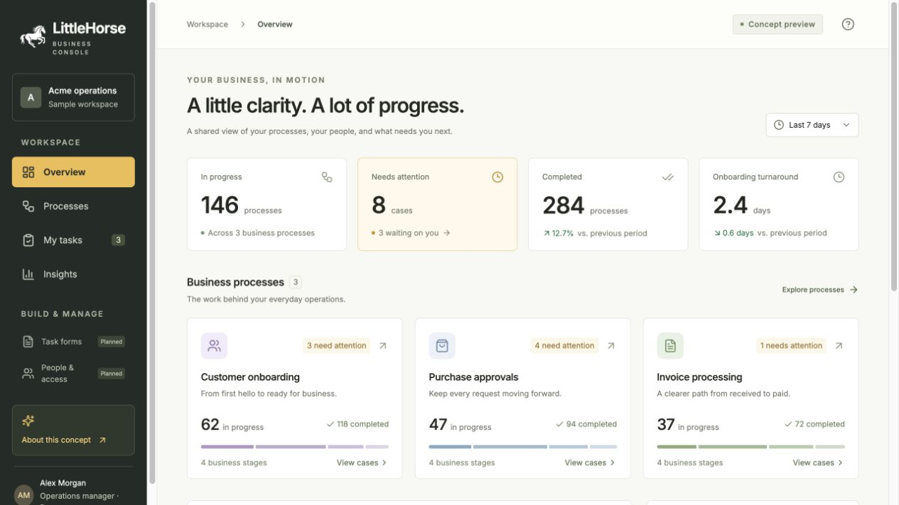
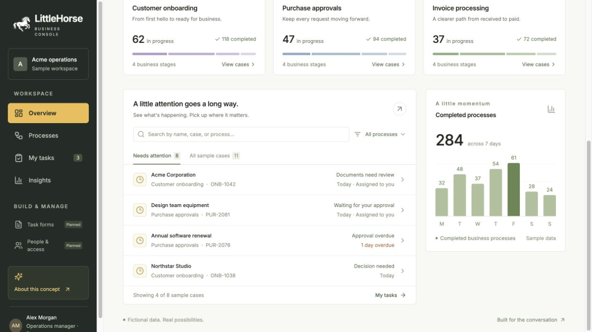
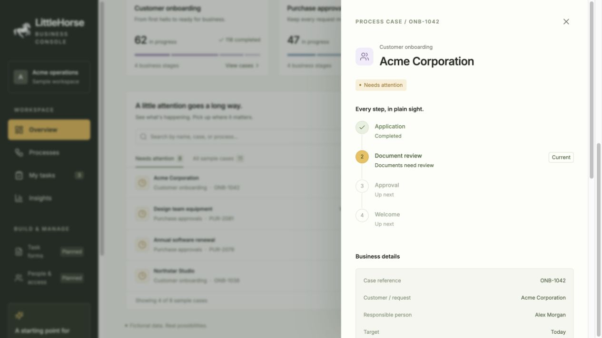

# Business Console home page concept

An interactive starting point for the team discussion, on branch
`codex/home-page-brainstorm`. The existing Next.js console renders this concept
at `/home-preview`; it requires no LittleHorse server, identity provider, or
Diffuser. All cases, names, metrics, and history are fictional.

## Preview







## Run

From the repository root, using the versions listed in the main README:

```sh
pnpm install --frozen-lockfile
pnpm --dir api-client build
LHUT_METRICS_DISABLED=true pnpm --dir console dev --hostname 127.0.0.1 --port 3100
```

Open <http://127.0.0.1:3100/home-preview>.

## Explore

- **Overview:** portfolio of business processes, cross-process counts, attention
  queue, and completion activity.
- **Processes:** filter by process, status, customer/request, case reference, or
  responsible person. The fixture list is a representative subset of the totals.
- **Case details:** business stages in a step tracker, public-facing business
  details, and a readable event history.
- **My tasks:** the sample user's outstanding reviews. Approve a review with a
  note to advance the case and update its attention count, or request changes
  and see the note in case history. Changes last until reload.
- **Insights:** switch between 7- and 30-day illustrative reports and compare
  process turnaround times. In-progress and attention counts are current-state
  snapshots; completion counts and turnaround use the selected reporting period.
- **About this concept:** the scope and questions for the next team discussion.

Task forms and people/access appear as planned navigation ideas. There is no
workflow designer, template builder, access-control implementation, or live
report query engine in this prototype. The home concept is deliberately a
separate route so existing task-management screens remain usable.

## Basis in the October 26 recording

The recording is product context, not an instruction to carry out every action
mentioned in the meeting. The relevant discussion points were:

| Approximate time | Design implication                                                                                                            |
| ---------------- | ----------------------------------------------------------------------------------------------------------------------------- |
| 03:20–07:15      | Design for business people; express progress as business stages rather than engine nodes. Phase one reads existing processes. |
| 07:22–09:51      | Show metrics that managers and business analysts can interpret, such as time to complete a business stage.                    |
| 15:26–18:53      | Start with a home page and sidebar in the actual frontend; use the visualization to discuss the backend data it will need.    |
| 19:26–21:28      | Give assigned user tasks a place in the sidebar; the existing task-oriented roles need further design.                        |
| 29:43–31:23      | Use a branch of the repository for an initial UI that both collaborators can change. This is a discovery artifact.            |
| 34:00–36:27      | Explore filtering and reports; detailed query/report configuration remains future work.                                       |
| 41:56–43:02      | Business metrics may combine multiple workflow specifications. The overview totals therefore span business processes.         |

The example business processes, visual style, fixture values, and information
hierarchy are proposals for discussion, not settled requirements from the call.

## Questions to resolve

1. Which audience and role should the default home serve?
2. Should the most prominent content be exceptions, personal tasks, or metrics?
3. How are business stages named and mapped to one or more workflow specs?
4. Which metrics need to aggregate across processes, and over what windows?
5. What belongs in the home summary versus a separate task or process screen?
6. Where should task-form authoring, permissions, and future templates live?

## Implementation boundaries

- `console/src/app/home-preview/` contains only the prototype and fixtures.
- The auth proxy excludes exactly `/home-preview` and its trailing-slash variant.
  Tenant routes and similarly named routes still pass through authentication.
- The root session provider receives an empty session only on that exact demo
  route, avoiding identity-provider calls when previewing fixtures.
- No backend, schema, generated API contract, or production data is changed.

## Validation

```sh
pnpm --dir console test
pnpm --dir console exec tsc --noEmit
LHUT_METRICS_DISABLED=true pnpm --dir console build
```

The proxy regression test verifies that the exact preview route is public and
that tenant routes, preview subpaths, and similar prefixes retain authentication.
Manual browser checks cover navigation, combined filtering, empty results,
reporting periods, the case tracker, required review notes, sample completion,
request-changes history, Escape dismissal, and a 390px mobile viewport.
