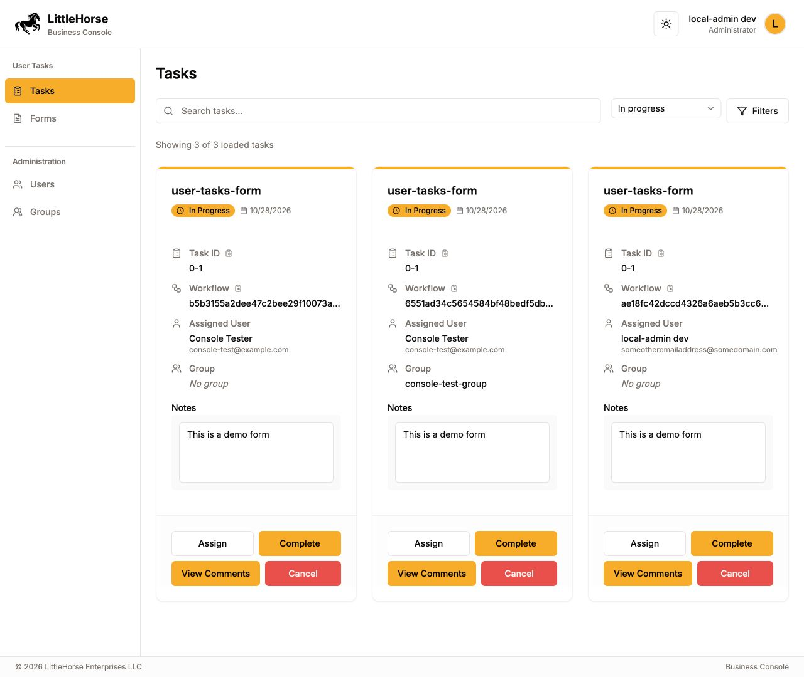
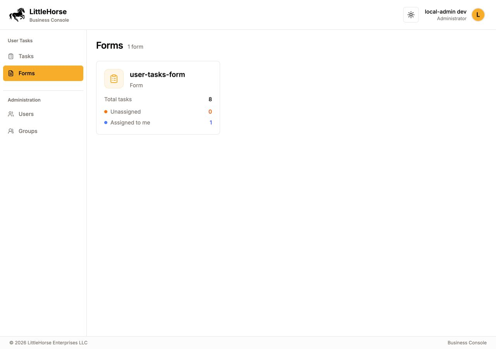
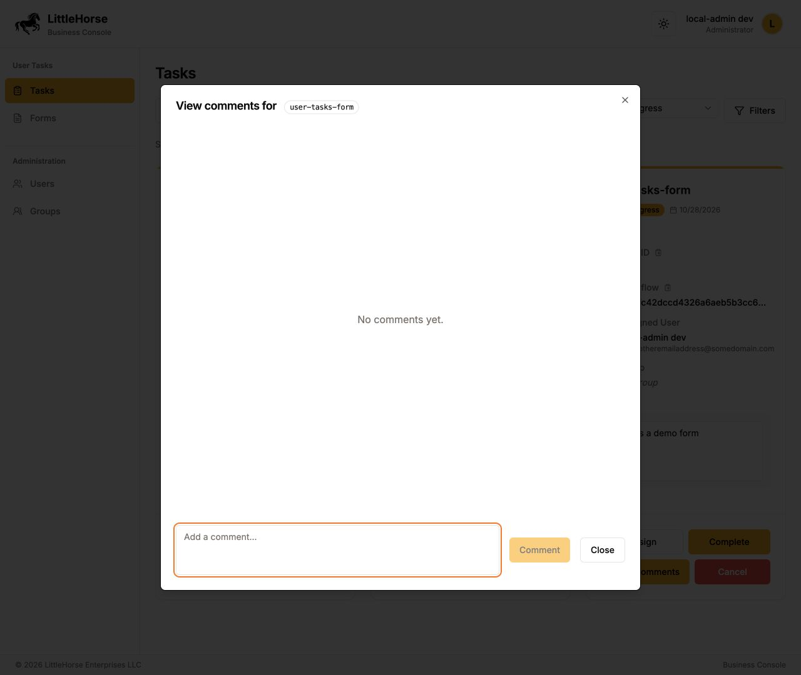

# Business Console: User Tasks refactor

Branch: `codex/home-page-brainstorm`.

The October 28 meeting narrowed the next step to moving the existing User Tasks
Bridge screens into the Business Console sidebar. The authenticated application
now uses the existing backend, forms, task actions, users, and groups. The earlier
order dashboard remains at `/home-preview` as a separate, sample-data concept;
it is not the application landing page.

## Preview







[Mobile task view](user-task-refactor/mobile.png)

## Decisions from the meeting

Source: the supplied 24:58 Zoom recording, `video1671677937.mp4` and its separate
`audio1671677937.m4a`. The transcript was checked against sampled video frames,
including the side-by-side screens and annotations. Times are relative to the
recording. Media and the full transcript remain outside this repository.

| Time        | Decision                                                                      | Implementation                                                                                                    |
| ----------- | ----------------------------------------------------------------------------- | ----------------------------------------------------------------------------------------------------------------- |
| 00:04–00:12 | Use workflow terminology rather than processes.                               | The earlier workflow concept uses the agreed wording. Business-facing navigation avoids metadata type names.      |
| 00:29–03:10 | Start from the working User Tasks UI and retain its capabilities.             | Reuse the existing task cards, forms, dialogs, API actions, and management components.                            |
| 06:51–08:00 | People who only complete tasks should have a focused entry point.             | Ordinary users land on their tasks, with no admin menu. Existing role checks remain in place.                     |
| 09:02–10:47 | Group form and task views beneath User Tasks; start with this menu.           | The sidebar contains Tasks and Forms; Users and Groups sit under Administration.                                  |
| 16:18–17:04 | Treat the first step as a refactor; define workflow visualization separately. | The authenticated landing page contains real tasks. Workflow and analytics views are not added to its navigation. |
| 18:23–19:09 | Comments must carry over to the new interface.                                | Existing comment create/edit/delete dialogs remain attached to task cards.                                        |
| 19:09–21:25 | Remove large account-count cards; keep counts in their relevant views.        | Forms have a small count; user/group tables and task lists retain inline result counts.                           |
| 24:23–24:40 | Carry the sidebar and all current features over incrementally.                | Existing routes, profile view switching, filters, pagination, and task actions remain available.                  |

## Navigation and existing capabilities

| View                | URL beneath `/<tenant>`         | Existing behavior retained                                                                                                     |
| ------------------- | ------------------------------- | ------------------------------------------------------------------------------------------------------------------------------ |
| Administrator tasks | `/admin` or `/admin?view=tasks` | Tasks across forms, search, status/date/group filters, pagination, assignment, completion, cancellation, comments, and results |
| Forms               | `/admin?view=forms`             | Registered forms, per-form task counts, and opening the tasks for a form                                                       |
| Tasks for a form    | `/admin/<form-name>`            | All statuses for that form, filters, pagination, task actions, and a link back to Forms                                        |
| Users               | `/admin?view=users`             | Create, edit, enable/disable, role changes, passwords, groups, and deletion through the existing management component          |
| Groups              | `/admin?view=groups`            | Create, edit, membership management, individual/bulk deletion, and pagination                                                  |
| My tasks            | `/`                             | Assigned tasks, search, filters, completion, cancellation, results, and comments                                               |
| Available tasks     | Available tasks tab on `/`      | Group selection, pagination, and claiming tasks                                                                                |

Administrators can still switch to the user view from the account menu. Legacy
`?tab=tasks`, `?tab=users`, and `?tab=groups` links resolve to their original
form/user/group views. Administrator controls are omitted for ordinary users;
the existing authentication proxy and backend authorization still protect them.

The existing search API needs a status when searching across forms. The new
administrator task view therefore starts with **In progress**, with **Available**,
**Completed**, and **Cancelled** options. Selecting a form still permits all
statuses. Task filters preserve the selected sidebar view, and only supported
filter parameters are forwarded to the API. Result counts describe loaded
records rather than claiming a global total.

If group lookup fails, assigned tasks remain available with a group-specific
error. Group lookup and claiming still require the identity provider permissions
expected by the existing adapter; the frontend does not change those permissions.

## Scope and deferred work

- Reuse `@littlehorse-enterprises/ui-library`, the approved sidebar styling, and
  the existing functional User Tasks screens. Status colors keep their meaning.
- Keep technical type names out of navigation and user-facing descriptions.
  Existing copyable task/workflow references remain available in task cards.
- No backend, protobuf, generated API client, authentication policy, or production
  data changes. Local verification uses the separate demo environment.
- Creating/registering forms and a form builder were discussed at 06:04–06:33
  and 17:30–18:23. They need a separate definition and are not represented by a
  nonfunctional create button or a new invented API.
- Workflow templates, status trackers, mapping multiple nodes to business steps,
  and analytics/data exploration were discussed as follow-up work, not this
  refactor. The sample order dashboard is retained only for that discussion.

## Run

Follow the repository README to start the backend and identity provider. Then:

```sh
pnpm install --frozen-lockfile
pnpm --dir api-client build
# Configure console/.env.local from console/.env.sample for your local services.
AUTH_URL=http://localhost:3101 LHUT_METRICS_DISABLED=true pnpm --dir console dev --hostname 127.0.0.1 --port 3101
```

Open <http://localhost:3101/default> for the user view or
<http://localhost:3101/default/admin> for the administrator view. Authentication
is required. The repository's demo administrator is `my-admin-user` / `1234`.
The earlier sample-only concept remains at `/home-preview`.

## Validation

```sh
pnpm --dir console test
pnpm --dir console exec tsc --noEmit
LHUT_METRICS_DISABLED=true pnpm --dir console build
```

Regression tests cover legacy navigation, preserving sidebar state when filters
change, forwarding only task filters to the API, existing role extraction, and
the exact public preview route. Browser verification uses real local API calls
for administrator and ordinary-user navigation, tasks by form/status, comments,
completion, results, assignment controls, available tasks/claiming, user/group
management views, and responsive layouts.
