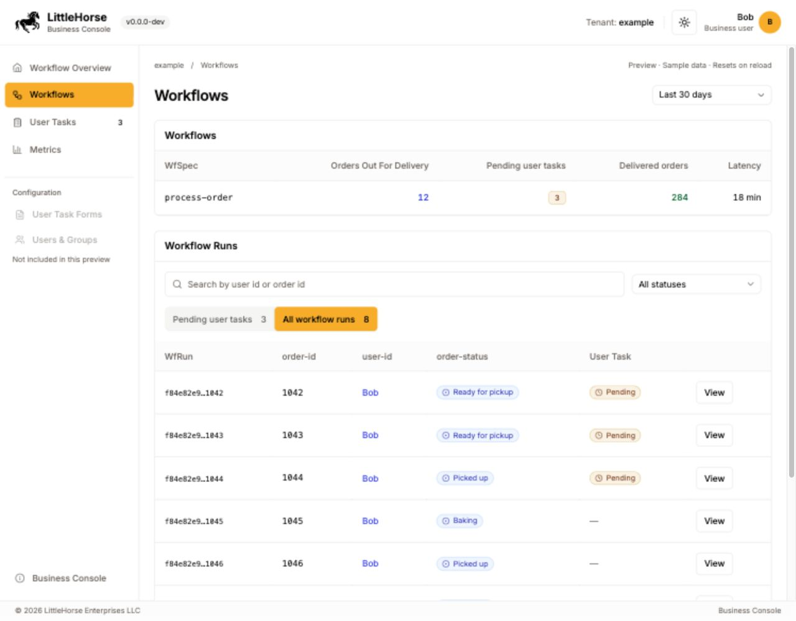
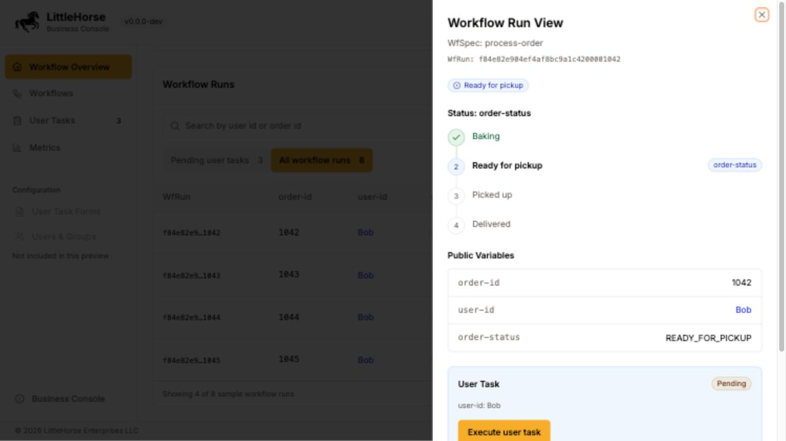

# Business Console: Workflow Overview

An interactive frontend for the initial Business Console discussion, on branch
`codex/home-page-brainstorm`. The existing Next.js console renders it at
`/home-preview`; it requires no LittleHorse server, identity provider, or
Workflow Diffuser. Workflow IDs, order IDs, counts, times, and history are sample
values. Actions reset on reload.

## Preview






## Terminology source

Product terminology and the example workflow come from the user-supplied
**Business Console Overview** PDF. The document describes itself as a proposal;
the frontend does not establish a production configuration or API contract.
Standard interface controls and sample-data annotations remain ordinary UI copy.

| UI terminology                                             | Document reference                                               |
| ---------------------------------------------------------- | ---------------------------------------------------------------- |
| Workflow Overview                                          | Page 2, Workflow Overview                                        |
| Workflows, WfSpec, WfRun, Workflow Run View                | Pages 1-2, Background and Workflow Run View                      |
| User Tasks; Pending; Executed                              | Pages 1 and 3, Execute User Tasks and important-step history     |
| Public Variables                                           | Page 1, business-friendly WfRun view; page 3, relevant variables |
| WorkflowEvents; Timeline                                   | Pages 1 and 3, WorkflowEvent history and timeline visualizer     |
| Metrics; Count; Latency                                    | Pages 2-4, Workflow Overview, Metrics, and Configuration         |
| Configuration; User Task Forms; Users, Groups, Permissions | Pages 1-4, feature and configuration sections                    |

The UI uses Workflow Runs for individual executions. It uses the configured
status variable for order progress, public variable names for fields, and User
Tasks for human actions.

## Example from the proposal

- **Workflow example:** `process-order`, the `business_flows` entry in the
  configuration example, used here as a sample WfSpec name.
- **Status variable:** `order-status`.
- **Status values:** `BAKING`, `READY_FOR_PICKUP`, `PICKED_UP`, `DELIVERED`.
- **Public variables:** `order-id`, `user-id`, `order-status`.
- **Count:** Orders Out For Delivery, counting `PICKED_UP`.
- **Latency:** average time from ready for pickup to delivered.
- **Delivered orders:** last 30 days and previous 30 days.
- **WorkflowEvents:** `order-picked-up` and `order-delivered`, with readable
  messages following the examples in the configuration section.
- **User:** Bob, the example user named in the permissions section.

The aggregate metrics and the eight visible WfRuns are sample values; the WfRun
list is a subset of the totals. The individual run view shows its status, public
variables, pending user task, and timeline. The sample user task has no configured
form fields; the proposal does not prescribe an input schema. Executing it
advances the sample order status and adds User Task and WorkflowEvent entries.
Agent executions, form management, permissions, templates, and backend
integration remain outside this frontend demonstration.

## Run

From the repository root, using the versions listed in the main README:

```sh
pnpm install --frozen-lockfile
pnpm --dir api-client build
LHUT_METRICS_DISABLED=true pnpm --dir console dev --hostname 127.0.0.1 --port 3100
```

Open <http://127.0.0.1:3100/home-preview>.

## LittleHorse styling

The UI uses `@littlehorse-enterprises/ui-library` for buttons, cards, tables,
badges, inputs, selects, tabs, dialogs, and the workflow run sheet. The theme
toggle comes from the existing console. The header and sidebar follow Saddle's
structure; typography and neutral tables follow existing LittleHorse projects.

Color has a consistent purpose in both light and dark themes:

| Color   | Meaning                                                                                    |
| ------- | ------------------------------------------------------------------------------------------ |
| Blue    | Order statuses before delivery, public user IDs, and user task execution                   |
| Amber   | Pending user tasks; LittleHorse's primary color also marks selected navigation and actions |
| Green   | Delivered orders and executed user tasks                                                   |
| Neutral | Latency without a configured target, future status values, IDs, and metadata               |

Color is accompanied by labels, values, or icons. No additional workflow status
or timing target is inferred from the sample values.

## Implementation boundaries

- `console/src/app/home-preview/` contains only the frontend and sample data.
- The auth proxy excludes exactly `/home-preview` and its trailing-slash variant.
  Tenant routes and similarly named routes still pass through authentication.
- The session provider receives an empty session only on that exact route.
- No backend, protobuf schema, generated API client, or production data changes.

## Validation

```sh
pnpm --dir console test
pnpm --dir console exec tsc --noEmit
LHUT_METRICS_DISABLED=true pnpm --dir console build
```

The proxy test checks the exact public route and protected tenant paths. Browser
checks cover the workflow and user-task views, search by user ID and order ID,
status filters, metric windows, user task execution, public variables, timeline
entries, Escape dismissal, light/dark themes, and desktop/mobile layouts.
